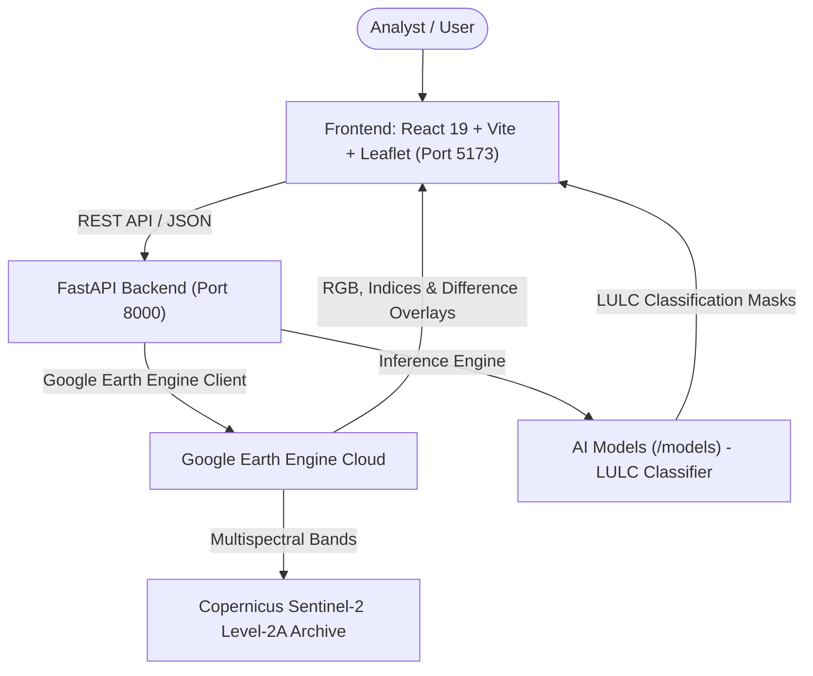
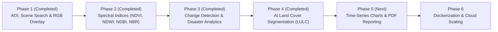

# Satellite Image Analyzer — Master Project Plan & Phase-Wise Roadmap

This document outlines the complete technical architecture, dataset specifications, model choices, and phase-wise implementation plan for the **Satellite Image Analyzer** platform.

---

## 1. Executive Summary & Architecture

The **Satellite Image Analyzer** is a cloud-native geospatial intelligence web platform designed to analyze Earth Observation satellite data for agriculture, water bodies, urbanization, and disaster monitoring.

### Tech Stack
* **Frontend**: React 19, Vite 8, Leaflet 1.9.4, Leaflet-Draw, Lucide icons (`http://localhost:5173`)
* **Backend**: FastAPI, Uvicorn, Google Earth Engine Python API (`ee`), Pydantic (`http://localhost:8000`)
* **Data & Models**: Google Earth Engine Cloud Catalog, EuroSAT, Multispectral Decision Classifiers, Jupyter Notebooks

---

## 2. Satellite Datasets Reference

### Primary Dataset: Copernicus Sentinel-2 Harmonized (`COPERNICUS/S2_SR_HARMONIZED`)
* **Constellation**: Twin polar-orbiting satellites (Sentinel-2A & Sentinel-2B) at 786 km altitude.
* **Temporal Revisit**: Every 5 days globally (2–3 days at mid-latitudes).
* **Processing Level**: Level-2A (Surface Reflectance / Bottom-of-Atmosphere, atmospherically corrected).

| Band | Name | Wavelength ($\mu m$) | Resolution | Primary Application |
| :--- | :--- | :--- | :--- | :--- |
| **B1** | Coastal Aerosol | 0.443 | 60 m | Coastal and atmospheric correction |
| **B2** | **Blue** | 0.490 | **10 m** | True-color RGB, water body discrimination |
| **B3** | **Green** | 0.560 | **10 m** | True-color RGB, vegetation reflectance |
| **B4** | **Red** | 0.665 | **10 m** | True-color RGB, chlorophyll absorption |
| **B5** | Red Edge 1 | 0.705 | 20 m | Plant stress and chlorophyll content |
| **B6** | Red Edge 2 | 0.740 | 20 m | Canopy structure |
| **B7** | Red Edge 3 | 0.783 | 20 m | Leaf Area Index (LAI) |
| **B8** | **Near-Infrared (NIR)** | 0.842 | **10 m** | **Crop biomass, NDVI, water delineation** |
| **B8A**| Narrow NIR | 0.865 | 20 m | Water vapor absorption correction |
| **B9** | Water Vapor | 0.945 | 60 m | Atmospheric correction |
| **B11**| **SWIR 1** | 1.610 | **20 m** | **Moisture content, soil, urban built-up (NDBI)** |
| **B12**| **SWIR 2** | 2.190 | **20 m** | **Wildfire burn scars (NBR), geology** |

---

## 3. The Models Used in the Project

### Category A: Physics-Based Spectral Models (Formulas - Real-Time)
Executed directly on Google Earth Engine servers:

1. **NDVI (Normalized Difference Vegetation Index)**:
   $$\text{NDVI} = \frac{\text{B8 (NIR)} - \text{B4 (Red)}}{\text{B8 (NIR)} + \text{B4 (Red)}}$$
   * **Target**: Healthy agricultural crops ($0.4 - 0.8$), forests, vegetation stress, drought.

2. **NDWI (Normalized Difference Water Index)**:
   $$\text{NDWI} = \frac{\text{B3 (Green)} - \text{B8 (NIR)}}{\text{B3 (Green)} + \text{B8 (NIR)}}$$
   * **Target**: Open water bodies, lakes, rivers, flood water delineation ($> 0$).

3. **NDBI (Normalized Difference Built-up Index)**:
   $$\text{NDBI} = \frac{\text{B11 (SWIR)} - \text{B8 (NIR)}}{\text{B11 (SWIR)} + \text{B8 (NIR)}}$$
   * **Target**: Concrete, asphalt, buildings, urban expansion.

4. **NBR (Normalized Burn Ratio)**:
   $$\text{NBR} = \frac{\text{B8 (NIR)} - \text{B12 (SWIR2)}}{\text{B8 (NIR)} + \text{B12 (SWIR2)}}$$
   * **Target**: Wildfire burn scars and fire damage severity.

5. **Bi-Temporal Differencing ($\Delta \text{Index}$)**:
   $$\Delta \text{Index} = \text{Index}_{\text{post-event}} - \text{Index}_{\text{pre-event}}$$
   * **Target**: Flood inundation mapping, deforestation quantification ($km^2$).

---

### Category B: Machine Learning & Semantic Segmentation Models ([`models/`](./models) & [`notebooks/`](./notebooks))

1. **Multispectral LULC Segmentation Classifier ([`models/landcover_classifier.py`](./models/landcover_classifier.py))**:
   * **Role**: Pixel-by-pixel Land Use / Land Cover (LULC) multi-class classification into 5 discrete categories:
     * 🟦 **Water Bodies** (`#419bdf`)
     * 🟩 **Trees & Dense Forest** (`#2d6a4f`)
     * 🟨 **Cropland & Agriculture** (`#70e000`)
     * 🟥 **Urban & Built-up** (`#d90429`)
     * 🟫 **Barren Soil & Rock** (`#ddb892`)
   * **Features**: Multi-band optical values ($B2, B3, B4, B8, B11, B12$) + calculated indices ($\text{NDVI}, \text{NDWI}, \text{NDBI}$).
   * **Inference Endpoint**: `POST /analyze-landcover` returning a 512px georeferenced segmentation mask and exact area statistics ($km^2$ and %).

2. **Experimentation & Prototyping Notebook ([`notebooks/01_landcover_segmentation.ipynb`](./notebooks/01_landcover_segmentation.ipynb))**:
   * Complete Jupyter notebook documenting the remote sensing data pipeline, spectral feature extraction, and frequency histogram analysis.

---

## 4. Phase-Wise Implementation Roadmap & Status

### **Phase 1: Foundation, Catalog Search & True-Color Visualization**
> **Status:**  **COMPLETED**

* [x] FastAPI server on port 8000 with CORS and `/health` endpoint.
* [x] Google Earth Engine integration (`apps-459204`).
* [x] `/search-scenes` taking BBox, date range, and cloud cover %.
* [x] Leaflet map with Leaflet-Draw rectangle AOI selector.
* [x] True-color (B4, B3, B2) georeferenced satellite overlay on map with opacity slider.

---

### **Phase 2: Multispectral Indices (NDVI, NDWI, NDBI, NBR)**
> **Status:**  **COMPLETED**

* [x] Endpoint `POST /get-spectral-index` supporting 6 layers (`TRUE_COLOR`, `NDVI`, `NDWI`, `NDBI`, `NBR`, `FALSE_COLOR`).
* [x] Automated color palette rendering with min/max contrast stretching.
* [x] Dynamic Color Gradient Legend Bar with contextual labels.
* [x] Zonal statistics calculation (mean index value, condition classification, and surface distribution breakdown).
* [x] Frontend layer selector tabs with real-time map overlay switching.

---

### **Phase 3: Multi-Temporal Change Detection & Disaster Analytics**
> **Status:**  **COMPLETED**

* [x] Endpoint `POST /analyze-change` for bi-temporal satellite comparison.
* [x] Support for 3 disaster & change analysis modes (`VEGETATION`, `WATER_FLOOD`, `BURN_SEVERITY`).
* [x] Earth Engine pixel area reducers calculating exact total AOI ($km^2$), impacted area ($km^2$), and $\%$ change.
* [x] Frontend `ChangeDetectionPanel` with Before ($T_1$) and After ($T_2$) scene selectors.
* [x] Quantitative impact metrics dashboard and georeferenced change heatmap overlay on Leaflet.

---

### **Phase 4: AI & Machine Learning Land Cover Semantic Segmentation**
> **Status:**  **COMPLETED**

* [x] Dataset guidelines and EuroSAT documentation in [`data/README.md`](./data/README.md).
* [x] End-to-end multi-spectral segmentation pipeline in [`models/landcover_classifier.py`](./models/landcover_classifier.py).
* [x] Interactive Jupyter training and evaluation notebook in [`notebooks/01_landcover_segmentation.ipynb`](./notebooks/01_landcover_segmentation.ipynb).
* [x] FastAPI endpoint `POST /analyze-landcover` returning georeferenced color-coded segmentation mask + area metrics ($km^2$ and %).
* [x] Frontend `LandCoverPanel.jsx` with class breakdown progress bars, dominant class callout, and Leaflet map overlay controls.
* [x] Mode Switcher in top navigation with 3 modes: Multispectral (Phase 1 & 2), Change Detection (Phase 3), AI Land Cover (Phase 4).

---

### **Phase 5: Time-Series Trends, Automated PDF Reporting & Gemini AI Synthesis**
> **Status:** 🟢 **COMPLETED**

* [x] 12–24 month historical NDVI/NDWI trendline API (`POST /get-timeseries`).
* [x] Interactive Chart.js time-series analytics and phenological metrics dashboard.
* [x] Geospatial intelligence PDF report generator with `html2canvas` & `jspdf`.
* [x] Google Gemini Cloud LLM integration (`POST /generate-ai-report`) converting multi-spectral metrics, EuroSAT classifications, and hazard change detection into executive, human-interpretable intelligence briefings.
* [x] Graceful fallback engine ensuring zero crashing if API key is not configured.

---

### **Phase 6: Containerization & Cloud Deployment**
> **Status:** ⚪ **Planned**

* [ ] `backend/Dockerfile` and `frontend/Dockerfile`.
* [ ] `docker-compose.yml`.
